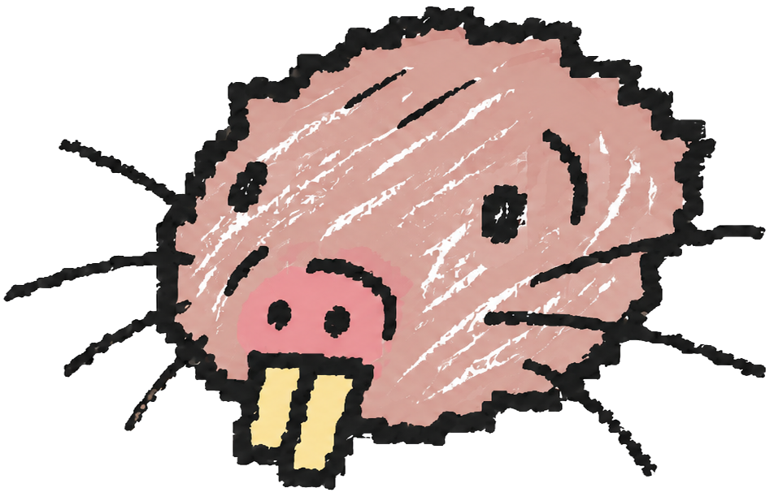

<p align="center">
  
  <br><br>
  <a href="https://github.com/orhun/molerat/releases"></a>
  <a href="LICENSE-MIT"></a>
  <br>
  <a href="https://crates.io/crates/molerat"></a>
  <a href="https://docs.rs/molerat"></a>
  <a href="https://ratatui.rs"></a>
</p>

# molerat

An accessibility & agentic layer for Rust UI applications, built on [AccessKit](https://github.com/AccessKit/accesskit) 🐀

## Quickstart

```bash
cargo add molerat
```

Add **molerat** to your app and publish a semantic view alongside your existing UI:

```rust
use molerat::Molerat;

let mut molerat = Molerat::new("Notes");
molerat.publish(|ui| {
    ui.text("status", "All changes saved");
});
```

See the available semantic UI components in the [API documentation](https://docs.rs/molerat/latest/molerat/struct.Ui.html).

If you have actions in your app, define an enum and return them from your UI handlers:

```rust
#[derive(Debug)]
enum Message {
    Save,
}

let mut molerat = Molerat::<Message>::new("Notes");
molerat.publish(|ui| {
    ui.button("save", "Save").on_click(|| Message::Save);
});
```

See the available semantic actions in the [API documentation](https://docs.rs/molerat/latest/molerat/struct.Node.html).

To handle the incoming actions:

```rust
for message in molerat.messages() {
    match message {
        Message::Save => { /* update app state */ }
    }
}
```

## Examples

- [`ratatui-recipe-atspi`](./examples/ratatui-recipe-atspi.rs): An app that speaks Ratatouille recipe.
- [`ratatui-dashboard-atspi`](./examples/ratatui-dashboard-atspi.rs): An app that speaks the system stats.
- [`ratatui-recipe-mcp`](./examples/ratatui-recipe-mcp.rs): Task queue controlled by agents.
- [`ratatui-sqlite-mcp`](./examples/ratatui-sqlite-mcp.rs): SQLite workbench controlled by agents.
- [`ratatui-paint-mcp`](./examples/ratatui-paint-mcp.rs): Drawing canvas controlled by agents.

Run one with:

```bash
cargo run --example <example-name> --features <mcp|atspi>

# For example:
cargo run --example ratatui-recipe-atspi --features atspi

# The MCP examples require the stdio bridge (molerat-mcp) to be installed:
cargo install molerat --features mcp --bin molerat-mcp
cargo run --example ratatui-recipe-mcp --features mcp
```

The examples above are built with [Ratatui](https://ratatui.rs/), but **molerat** is not designed for any specific UI framework.

> [!TIP]
> If you want to integrate **molerat** with Ratatui, see the [migration guide](./RATATUI_MIGRATION.md) or simply give that document as a prompt to your agent 🧀

## Showcase

Here is [knife](https://github.com/bl4ckr0ss3/knife) (a reverse-engineering TUI) solving a crackme challenge:

https://github.com/user-attachments/assets/586710de-214c-468c-91b7-0126d7a25592

Here is [BugStalker](https://github.com/godzie44/BugStalker) (a Rust debugger) debugging an application:

https://github.com/user-attachments/assets/ff256f9a-4f7b-4374-a7d3-5d91e2ebec55

## Integrations

### Screen readers

You can use the [AT-SPI](https://en.wikipedia.org/wiki/Assistive_Technology_Service_Provider_Interface) to expose your UI/actions to screen readers on Linux!

1. Enable `atspi` feature:

```bash
cargo add molerat --features atspi
```

2. And then adjust your constructor to use AT-SPI:

```rust
let mut molerat = Molerat::<Message>::new_atspi("Notes");
```

Nothing else is needed!

### Agents

You can use the [Model Context Protocol (MCP)](https://en.wikipedia.org/wiki/Model_Context_Protocol) to expose your UI/actions to agents!

1. Install the `molerat-mcp` stdio bridge and register it with your MCP client:

```bash
cargo install molerat --features mcp --bin molerat-mcp
```

2. Register the installed binary with your MCP client. e.g. Codex:

```bash
codex mcp add molerat -- "$(command -v molerat-mcp)"
```

3. Enable `mcp` feature:

```bash
cargo add molerat --features mcp
```

4. And then you can change your constructor to use the MCP bridge:

```rust
let mut molerat = Molerat::<Message>::new_mcp("Notes")?;
```

That's it! Your app is now agentic and can be controlled by your favorite agent.

## License

Licensed under either of [Apache License Version 2.0](./LICENSE-APACHE) or [The MIT License](./LICENSE-MIT) at your option.

🦀 ノ( º \_ º ノ) - respect crables!

## Copyright

Copyright © 2026, [Orhun Parmaksız](mailto:orhunparmaksiz@gmail.com)
